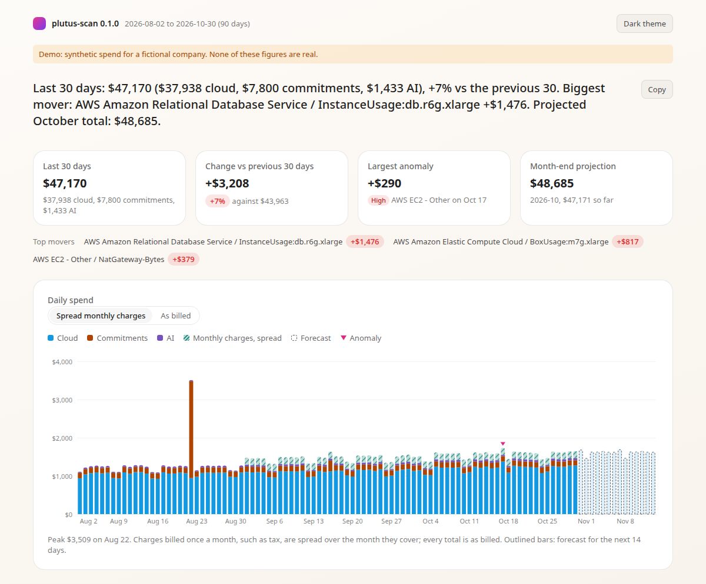

# plutus-scan

What changed in my cloud and AI bill, and where? One command, runs on your machine.



```
npx plutus-scan
```

It reads your AWS bill through your own `aws` CLI, plus OpenAI and Anthropic spend if you give it an admin key, plus any FOCUS export you point it at. It prints a summary that leads with one quotable sentence. In a terminal it then writes a self-contained HTML report to your temp folder (`plutus-scan/report-<last day>.html`) and opens it; pass `--no-open` to skip opening or `--no-html` to skip the report. Piped output and CI runs print the summary only. Use `--html <file> --open` to choose the path, or `--md` or `--json` for a Markdown summary or JSON.

## Try it without an account

```
npx plutus-scan --demo
```

`--demo` reports on 90 days of synthetic spend for Example Corp, a fictional company: AWS services (including EBS snapshots in a dozen regions, and a spread of small charges that make about twenty candidates to review), a little OpenAI and Anthropic, Savings Plan and Reserved Instance fees, an upfront purchase, tax, and tags with about a quarter of spend untagged. It contacts no provider and reads no credentials. The data is generated from a fixed seed, so every run gives the same figures, with one real spike, one service that steps up and stays up, and one small wobble that should not count as an anomaly. It takes the same output flags as a real run, such as `--html report.html --open`, and can't be combined with flags that would read an account.

The summary it prints starts like this (trimmed):

```
Headline
Last 30 days: $49,619 ($40,388 cloud, $7,800 commitments, $1,431 AI), +7% vs the previous 30.
Biggest mover: AWS Amazon Relational Database Service / InstanceUsage:db.r6g.xlarge +$1,476.
Projected November total: $50,375.

Top drivers (last 30 days against the previous 30)
                                                        last 30   previous     change   share
AWS Amazon Relational Database Service                   $6,095     $4,619    +$1,476   38.5%
  USE1-InstanceUsage:db.r6g.xlarge                       $6,095     $4,619    +$1,476
AWS Amazon Elastic Compute Cloud                        $19,729    $18,788      +$941   24.5%
  USE1-BoxUsage:m7g.xlarge                              $19,688    $18,749      +$939
AWS EC2 - Other                                          $3,792     $3,356      +$436   11.4%
  USE1-NatGateway-Bytes                                  $2,201     $1,833      +$368

Anomalies
                                                           cost       baseline     change  severity
2026-10-29 AWS EC2 - Other                                 $438           $116      +$323      high

AI by project
OpenAI support-bot                                       $1,590   41.3%
Anthropic support-bot                                    $1,586   41.2%
OpenAI search-assist                                       $672   17.5%
```

The dates follow the day you run it; the figures do not change.

## What it calls and what it doesn't

plutus-scan runs locally. Nothing leaves your machine except the requests below, and it sends no telemetry and makes no update check. It never contacts plutus-cloud.com.

**Hosts.** Only the ones you configure:

| Host | Path | When |
|---|---|---|
| `api.openai.com` | `GET /v1/organization/costs`, `GET /v1/organization/projects` | `OPENAI_ADMIN_KEY` or `--openai-key` is set |
| `api.anthropic.com` | `GET /v1/organizations/cost_report`, `GET /v1/organizations/workspaces` | `ANTHROPIC_ADMIN_KEY` or `--anthropic-key` is set |
| `api.github.com` | `GET /repos/<owner>/<repo>/releases` | you pass `--github owner/repo` |
| `api.github.com` | `POST /graphql` (read-only queries) | you pass `--github <org or user>` |

**AWS goes through your own `aws` CLI.** plutus-scan never reads your AWS credentials and does not bundle an SDK. It inherits whatever profile, SSO session or environment variables your `aws` already uses (`--profile` is passed through). It runs only these commands:

- `aws sts get-caller-identity`, to check that credentials work
- `aws ce get-cost-and-usage`
- `aws ce list-cost-allocation-tags`
- `aws s3 ls <prefix> --recursive` and `aws s3 cp <object> -`, only for an `s3://` FOCUS input

It needs AWS CLI v2 on your PATH. If `aws` is missing or not signed in, AWS is skipped and the report says so.

**GitHub can use your `gh` CLI login the same way.** When you pass `--github` and set no token, plutus-scan runs `gh auth token --hostname github.com` (no shell, a 5-second timeout) and uses what it prints. That is the only `gh` command it runs, it runs only when `gh` is on your PATH, and a missing `gh`, an error or empty output just means no token. `--no-gh-auth` turns this off. `--demo` never runs it.

**Keys.** `OPENAI_ADMIN_KEY`, `ANTHROPIC_ADMIN_KEY` and the GitHub token (optional for single repos, required for an org; from `--github-token`, `GITHUB_TOKEN`, `GH_TOKEN` or your `gh` login, in that order) are read from flags, the environment or `gh`. They are never written to disk, logged or included in any output; `--dry-run`, the notes and the progress line name only where a key came from.

**The HTML report cannot call out.** It is one file with its data inlined and its chart drawn as inline SVG, system fonts only, and this content security policy:

```html
<meta http-equiv="Content-Security-Policy" content="default-src 'none'; script-src 'unsafe-inline'; style-src 'unsafe-inline'; img-src data:">
```

To check it, open the report in a browser, open devtools, and look at the Network tab (it stays empty after load) and at the `<meta>` tag in the Elements tab. The `default-src 'none'` rule means the page cannot fetch anything, even if something tried.

**Dependencies.** One runtime dependency, `hyparquet`, for Parquet FOCUS files, pinned exactly with the lockfile committed.

### Read-only IAM policy

This is everything the AWS part needs:

```json
{
  "Version": "2012-10-17",
  "Statement": [
    {
      "Effect": "Allow",
      "Action": [
        "ce:GetCostAndUsage",
        "ce:ListCostAllocationTags"
      ],
      "Resource": "*"
    }
  ]
}
```

An `s3://` FOCUS input also needs `s3:ListBucket` and `s3:GetObject` on that bucket, and `kms:Decrypt` if the bucket is encrypted with a KMS key. In an AWS Organization, Cost Explorer shows all accounts only from the management account; a member account sees its own spend.

### Cost Explorer pricing

AWS charges $0.01 per Cost Explorer API request. A run makes at least 4 billed requests (the daily query, the service drill-down, the candidate query and the tag list), plus one for each active cost allocation tag key it measures (up to 5), so a typical run is 4 to 10 requests, about four to ten cents. Each page of results is one request, so a large AWS Organization, whose daily spend can run to many pages, makes more. There is no cap by default, so a run never stops early; `--max-aws-requests <n>` sets a hard limit if you want one. If that cap is reached, plutus-scan stops, uses what it has, and a note names what was skipped and whether the totals are complete. Every output states the actual request count and cost; if every source fails, the count and cost still go to stderr. Listing cost allocation tags is also a billed request.

### See the requests before they happen

`--dry-run` lists every request it would make (host and path, or the exact `aws` command, shell-quoted so it can be pasted), which credential each one uses (the environment variable name only) and the estimated AWS cost, and makes none of them. The free `aws sts get-caller-identity` check is not listed, and the drill-down and tag commands show placeholders until real data picks the services and tag keys.

```
npx plutus-scan --dry-run --openai-key x
```

## Inputs and flags

With no flags it uses AWS if `aws` is signed in. Add whatever else you have.

| Input | How |
|---|---|
| AWS | default; `--profile <name>`, `--no-aws` to skip, `--aws` to force it when a FOCUS input already holds AWS rows (Cost Explorer then replaces the FOCUS AWS rows, and an unavailable AWS counts as a failed source) |
| OpenAI | `OPENAI_ADMIN_KEY` or `--openai-key`; spend by model and by project |
| Anthropic | `ANTHROPIC_ADMIN_KEY` or `--anthropic-key`; spend by model and by workspace. Priority Tier spend is not in this API, and every output says so |
| FOCUS | `--focus <path>`, repeatable: a file, a directory (recursive; `.csv`, `.csv.gz`, `.parquet`) or an `s3://` prefix |
| GitHub releases | `--github owner/repo` or `--github <org>`, repeatable and mixed; marks releases on the chart and shows the nearest ones beside an anomaly, as context and never as a cause (see below) |

FOCUS is the way in for Azure, GCP and OCI, or for anyone who already has an export. Required columns are `BilledCost`, `ChargePeriodStart` and `BillingCurrency`. Parquet is read uncompressed or Snappy only, with a clear message otherwise. The files in one directory (or one `s3://` prefix) count as one export, so multi-part exports are summed; when two exports cover the same provider and day, the one with the newest file wins and a note says so. To try the tool without your own data, download the official [FOCUS 1.0 sample](https://github.com/FinOps-Open-Cost-and-Usage-Spec/FOCUS-Sample-Data) (`FOCUS-1.0/focus_sample.csv`) and run `npx plutus-scan --focus focus_sample.csv --end 2024-09-30 --days 30 --no-aws` (the sample covers September 2024).

Other flags:

```
--days <n>                 Days to report, ending at --end (default 90, max 395)
--end <YYYY-MM-DD>         Last day of the window (default: two days ago, UTC)
--max-aws-requests <n>     Optional cap on billed Cost Explorer requests (no cap by default)
--max-tag-keys <n>         Cost allocation tag keys to measure (default 5)
--github <owner/repo>      Mark releases of this repo on the chart (repeatable)
--github <owner>           Mark releases of every repo in this org or user (repeatable; needs a token)
--github-exclude <o/repo>  Leave this repo of an org out (repeatable)
--github-token <token>     GitHub token (default: GITHUB_TOKEN, then GH_TOKEN, then your gh login)
--no-gh-auth               Do not ask the gh CLI for its login's token
--html <file> [--open]     Write a self-contained HTML report to a path you choose
--no-html                  Skip the automatic HTML report
--no-open                  Write the automatic HTML report without opening it
--json <file|->            Write the report data as JSON
--md <file|->              Write a Markdown summary
--tui                      Full-screen keyboard view
--braille                  Braille sparkline
--no-color                 No colour in the terminal summary
--dry-run                  List every request without making any
```

**GitHub releases.** `--github owner/repo` reads one repo's releases, with or without a token. `--github acme` (no slash) reads every repo in the org `acme`, or of the user `acme` when no org has that name, leaving out archived repos and forks; `--github-exclude acme/nightly` leaves out a noisy one. Both forms can be repeated and mixed, and a repo its org already covers is read once. Org mode uses the GraphQL API, which needs a token: without one the run stops before any request, since GitHub also allows only 60 unauthenticated requests an hour. The token is the first of `--github-token`, `GITHUB_TOKEN`, `GH_TOKEN` and your `gh` CLI login, so if you already use `gh`, `gh auth login` once is all the setup there is; with a single repo, the `gh` login lifts that 60-an-hour limit too. A note in the report and the progress line say where the token came from ("via gh login", "via GITHUB_TOKEN", "via --github-token"), never the token. One query reads 100 repos with each repo's 20 newest releases, so a 200-repo org takes two calls; a repo is paged further only while its newest releases are still inside the window. The token needs read access to the repos (a fine-grained token with Contents read, or a classic token with `repo` for private ones); a note says how many repos were read and how many had releases in the window, and when only public repos were visible. Drafts are skipped and prereleases are kept, since a release candidate is often what a staging stack runs. Releases on the same day are one chart marker ("3 releases", each named in the tooltip), the chart draws at most 30 release days (any an anomaly points at first, then the busiest), and an anomaly's context names every release of its nearest release day with its repo. `--dry-run` lists an org as one GraphQL request plus an estimate, because its size is not known until it is read. GitHub requests are free and counted on the progress line ("acme: 143 repos, 37 releases; 3 requests via gh login").

The window ends two days ago by default, because the last day or two of billing data is incomplete. Mixed currencies are not converted: the dominant currency is used and the rest are listed as excluded.

**Commitments.** Savings Plans and Reserved Instance charges are counted as commitments, a third category beside cloud usage and AI. From Cost Explorer these are the Savings Plan recurring and upfront fees and the Reserved Instance fees, under each name Cost Explorer has used for them (`SavingsPlanRecurringFee`, `SavingsPlanUpfrontFee`, `RIFee`, `Recurring` or `Recurring reservation fee`, `Fee`, `Upfront` or `Upfront reservation fee`). They are shown as the Savings Plan name, as `<service> reservations` for the monthly reservation fee, or as `<service> upfront fees` for a fee charged on purchase; from a FOCUS export they are `Purchase` rows. Commitments count in every total and in the month-end projection, appear in the headline and on the chart when there are any, and are drivers in their own right, but they are never flagged as anomalies (a Reserved Instance fee lands on the 1st of every month) or listed as candidates, and a service's usage types never include its fees.

**AI in a FOCUS export.** Rows whose provider or publisher is an AI provider (OpenAI, Anthropic, Mistral AI, Cohere and similar), or whose `ServiceCategory` is `AI and Machine Learning`, are AI spend, reported by project (the sub-account) like the OpenAI and Anthropic sources, and left out of the untagged share. A `Purchase` row stays a commitment. AI billed through live AWS Cost Explorer, such as Bedrock, stays cloud, because Cost Explorer does not say which services are AI.

**Monthly charges.** Tax, a monthly Reserved Instance fee and other charges billed once on the 1st for the whole month are spread over that month in the daily charts (HTML, terminal and TUI) and in the forecast, drawn as a hatched "Monthly charges, spread" segment, so the 1st does not look like a spike. The HTML report has an "As billed" switch to see them on their day. Totals, the headline, drivers and tables stay as billed, and these charges are never anomalies.

**Credits.** Credits and refunds count in every total, but anomalies are judged on charges before credits: a credit booked under a service would otherwise lower that weekday's baseline for four weeks and make an ordinary day look like a spike.

## Outputs

Every output leads with one quotable sentence: the last 30 days split into cloud and AI (and commitments, when there are any), the change against the previous 30, the biggest mover with its leading usage type, and the month-end projection. The terminal, HTML and TUI add the full headline block (top three movers and the largest anomaly). Every output also states what each source's amounts include (for AWS, UnblendedCost with credits, refunds and tax as billed), the last complete day and the currency, and when AWS was queried, the actual Cost Explorer request count and cost.

- **Progress**: on a terminal, while sources are read, a live panel on stderr shows one line per source (a spinner and its current step, then a tick, a cross or why it was skipped, with days, services, requests and cost), the analysis steps, and the running request count, Cost Explorer cost and elapsed time. It collapses to one summary line before the report, and the cursor always comes back, on Ctrl-C too. Piped output, CI, `--json` and `--md` keep plain one-line progress messages. See [demo-run.cast](docs/terminal-samples/demo-run.cast).
- **Terminal** (default): on a terminal, a dashboard: the headline, tiles for the last 30 days, the change, the forecast and commitments, a daily spend bar chart stacked by cloud, commitments and AI with the forecast and anomaly marks, top movers beside the largest anomaly, top drivers with their usage types and a 60-day trend, anomalies, candidates to review (the five strongest, then a count of the rest), AI spend by project, then notes and the AWS request line. Colour uses 24-bit, 256 or 16 colours depending on `COLORTERM` and `TERM`; set `NO_COLOR` or pass `--no-color` to turn it off. Below 100 columns the layout is compact, and every line fits at 80. Piped output and CI runs get a plain summary of the same sections with no borders and no colour, so it stays stable to parse. Samples of both are in [docs/terminal-samples](docs/terminal-samples/).
- **`--md <file|->`**: the same content as GitHub-flavoured Markdown: the headline sentence, a drivers table, the top anomalies, the five strongest candidates and a count of the rest, and the basis. Tables and `<sub>` text render on GitHub (PR descriptions, issues, comments). Slack does not render them, so paste the headline sentence there instead.
- **`--json <file|->`**: the full report data with `schemaVersion: 1`, the tool version, the window, sources and row counts.
- **`--html <file>`**: the offline report described above: headline with a copy button, daily spend with anomaly and release markers and a dashed forecast, drivers and candidates that each open to a sub-table of their usage types (by region, cost and share), anomalies, AI by project, untagged share, and basis. It follows your light or dark preference, with a toggle, and prints cleanly in the light theme. plutus-scan prints a warning after writing it, because the file contains real spend figures. A report from `--demo` says at the top that its figures are synthetic, and a bare `--demo` run names its file `demo-report-<last day>.html`, so it never replaces a real report.
- **`--tui`**: a full-screen, keyboard-only view of the same data with overview, drivers and anomalies, and drill-in to usage types. `1` `2` `3`, Tab and Shift+Tab, or the left and right arrows switch views (wrapping, and from a drill-in too), arrows or `j` `k` move, Enter drills in, Esc goes back, `h` writes `plutus-scan-report.html` in the current directory, `q` quits. It needs a TTY of at least 80x24, checked before any request is made, and restores your terminal on exit. The overview shows the headline block, totals, the last complete day, the AWS request count and cost, and the basis and notes as far as the screen allows.

## Candidates to review

Candidates to review are not proven savings. They come from billing data only: usage types whose names point at a kind of charge that often hides waste, each sized by its last 30 days of spend. A candidate is a place worth a look. Whether the spend is waste depends on things a bill cannot show.

There are 46 AWS rules, service by service, and a usage type matches at most one of them:

- **Compute and storage**: idle and in-use public IPv4 addresses, NAT gateways, older EC2 generations, Dedicated Instances, burstable CPU credit charges, gp2, Provisioned IOPS and HDD or magnetic EBS volumes, snapshots and fast snapshot restore.
- **Network**: cross-AZ, inter-region and internet data transfer, Classic Load Balancer traffic, VPC interface endpoints, Transit Gateway.
- **Databases and caches**: older RDS, ElastiCache, OpenSearch and Redshift generations, RDS Multi-AZ, provisioned IOPS, backup storage and gp2 storage, Aurora I/O requests, DynamoDB provisioned capacity and backups.
- **Storage and serverless**: S3 Standard storage, requests and early-delete fees, Lambda provisioned concurrency and x86 duration, ECR storage.
- **Observability and security**: CloudWatch custom metrics and alarms, Logs ingestion, Logs storage and API requests, KMS keys and requests, Secrets Manager secrets, CloudTrail paid and data events, AWS Config.
- **Containers, streaming and ML**: EKS clusters and extended support, Kinesis shard hours, SageMaker endpoint and notebook hours.

Each rule has a strength. A candidate is "Often worth changing" when the billing line itself is evidence of something usually worth changing: an idle resource, a superseded generation or storage class with a cheaper like-for-like successor, or a surcharge such as extended support. It is "Worth a look" when the line is a legitimate cost that is only sometimes waste, such as S3 storage, an EKS control plane or provisioned capacity. When unsure a rule is "Worth a look". Candidates that Plutus can fix come first, then the strong ones, then the rest, each group by spend, so a big cost centre does not bury a small likely finding. `--json` carries a `strength` field (`"strong"` or `"look"`) on each candidate.

Candidates also work on Azure and Google Cloud, from a FOCUS export (`--focus`). There are 11 Azure rules (older VM series, Standard HDD and Premium SSD managed disks, unmanaged page blob disks, public IP addresses, Log Analytics ingestion and retention, inter-region and internet data transfer, VPN gateways, backup) and 8 Google Cloud rules (idle Cloud SQL addresses, static external IPs, standard persistent disks and snapshots, Cloud NAT, N1 instances, load balancer forwarding rules, Artifact Registry storage). They read the row's `ChargeDescription` and `ServiceName`, matched on strings seen in the official FOCUS sample data or in Google's own documentation, and are ordered and labelled the same way. Plutus does not open pull requests for them. A FOCUS export cannot say whether a disk or address is attached, so these too are places to look. Some signals are not covered because no real string was found for them, such as Google Cloud Logging ingestion and Azure NAT gateway.

A rule reads the name of a usage type and, where several services share a name, the service. It never reads utilisation, CloudWatch or your repos, so none of them can say a resource is idle, only that its kind of charge is worth checking. Each pattern was checked against real usage types in the public AWS Price List; the list of rules and what each matches is in [docs/design.md](docs/design.md). The terminal summary, the dashboard and the Markdown summary show the first five in that order and end with "and N more, listed in --json and the HTML report"; the HTML report and `--json` list every candidate over $10. Reading the rows costs no extra Cost Explorer request: the candidate query already covers every service on the bill.

For one of them, gp2 volumes, Plutus can open a pull request against your Terraform that fixes the waste (changing the volume type to gp3). That candidate says so beside its figure: "If this is waste, Plutus can open the pull request that fixes it." In the HTML report and the Markdown summary that sentence is a plain link; the plain terminal summary shows the sentence (the full-screen dashboard shortens it to "Plutus can open the fix as a pull request") and, once at the end of the section, the bare address `https://plutus-cloud.com/?utm_source=plutus-scan&utm_medium=cli` to follow. Printing it is not a request. plutus-scan itself recommends no code change and never looks in a repo, and every other candidate, idle public IPs included, says nothing about pull requests. `--json` carries a `plutusFix` field on each candidate (`"pull_request"` or `null`).

## What Plutus adds

plutus-scan is a snapshot of one bill, taken once. [Plutus](https://plutus-cloud.com/?utm_source=plutus-scan&utm_medium=readme) tracks the same spend daily, per team and per customer, with alerts, and is where the questions this tool leaves open get answered: who owns this AI project, is this candidate actually waste, what happens tomorrow. plutus-scan has no paid tier, license key or upload step, and works fully without it. The pull-request line on the gp2 candidate, and the link in the footer of every HTML and Markdown report, are the same kind of pointer: a link you can follow or ignore, never a request plutus-scan makes. It still never contacts plutus-cloud.com.

## Releasing

Releases are published to npm by [`.github/workflows/release.yml`](.github/workflows/release.yml) when a GitHub release is published, not from a laptop.

1. Bump `version` in `package.json` and `package-lock.json` with `npm version 0.1.1 --no-git-tag-version`, open a pull request and merge it to `main`.
2. On GitHub, draft a new release from `main` with a new tag named `v` plus the version (`v0.1.1`), write the notes and publish it. A version with a suffix such as `0.2.0-rc.1` is published under the npm `next` tag instead of `latest`.
3. The workflow checks that the tag matches `package.json`, runs `npm ci` and `npm test`, checks that the tarball holds only `bin`, `src`, `LICENSE`, `package.json` and `README.md`, and publishes with provenance. If any check fails nothing is published: fix it, delete the release and its tag, and publish again.

One-time setup: the workflow uses npm trusted publishing, so there is no npm token to store. On npmjs.com, under the package's Settings, add a trusted publisher for GitHub Actions with organization `plutus-cloud`, repository `plutus-scan`, workflow `release.yml` and environment `npm`. Once a release has gone out that way, you can set the package's publishing access to require two-factor authentication and disallow tokens.

## License

MIT. See `LICENSE`. The FOCUS sample used as a test fixture is CC BY 4.0, credited in `test/fixtures/focus/official-sample.NOTICE.md`.
